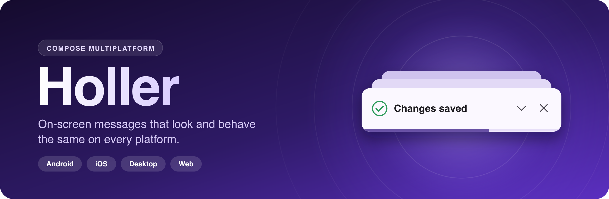
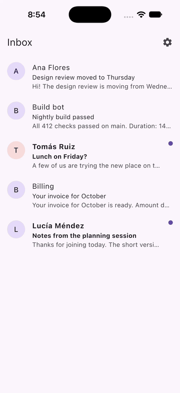

[](https://central.sonatype.com/artifact/io.github.mradzinski/holler)
[](https://github.com/mradzinski/Holler/actions/workflows/build.yml)
[](https://codecov.io/gh/mradzinski/Holler)

# Holler

On-screen messages for Compose Multiplatform. One implementation in common code, so a
message looks and behaves the same on **Android, iOS, Desktop and Web**, and it takes its look from
your app's Material theme.

- Title, optional long text that expands, icon, actions, countdown and progress bar
- Shown as plain text, or as one of your app's own objects that the host gives a look, so a view model
  carries nothing visual
- Actions next to the title, under the text or in the strip at the bottom; a close button at the top, at
  the bottom, or none
- Swipe to dismiss, and a timer that pauses while the message is pressed or hovered and stops when the
  user expands it
- Messages one under the other or in a pile, with a queue behind them, and ready-made or custom enter and
  exit animations
- Replace or close a message by its key, and wait to learn how it ended
- Follows the app's `MaterialTheme` by default: colors, typeface and shape, in light and in dark
- Colors, shape, text styles and shadow are all replaceable, for every message or for one
- Safe to call from any thread

| Stack | Pile |
|:---:|:---:|
|  |  |

## Contents

- [Before you begin](#before-you-begin)
- [Install](#install)
- [Quick start](#quick-start)
- [Key concepts of Holler](#key-concepts-of-holler)
  - [Message](#message)
  - [Holler](#holler)
  - [Host](#host)
  - [Handle](#handle)
  - [Key](#key)
  - [Actions scope](#actions-scope)
  - [Duration and timer](#duration-and-timer)
  - [Dismiss reason](#dismiss-reason)
- [Showing a message](#showing-a-message)
  - [Text messages](#text-messages)
  - [Your own messages](#your-own-messages)
  - [Parameters](#parameters)
  - [Behavior rules](#behavior-rules)
- [Manipulating a message](#manipulating-a-message)
  - [Replace](#replace)
  - [Update](#update)
  - [Dismiss](#dismiss)
- [Testing](#testing)
- [Theming](#theming)
  - [Default theme](#default-theme)
  - [Icons](#icons)
  - [Symbols of the expand and close buttons](#symbols-of-the-expand-and-close-buttons)
  - [Text and icons in slots](#text-and-icons-in-slots)
  - [Custom theming](#custom-theming)
- [Animations](#animations)
- [Accessibility](#accessibility)
- [Project layout](#project-layout)
- [Architecture](#architecture)
- [License](#license)

## Before you begin

The consuming app needs at least these versions:

| Dependency | Minimum version |
|---|---|
| Kotlin | 2.3.20 |
| Compose Multiplatform | 1.10.3 |
| Compose Material 3 | 1.9.0 |

Material 3 comes with the library; an app that already uses a newer one keeps it.

| Platform | Kotlin targets |
|---|---|
| Android | `android` |
| iOS | `iosArm64`, `iosSimulatorArm64`, `iosX64` |
| Desktop | `jvm` |
| Web | `js`, `wasmJs` |

Everything the library offers is in the package `io.github.mradzinski.holler`.

## Install

```kotlin
// build.gradle.kts, commonMain dependencies
implementation("io.github.mradzinski:holler:1.0.0-rc01")
```

With Gradle, the one line above is all you need on every platform: an Android-only or desktop-only
project uses it as it is.

**Maven and other build tools** that do not read Gradle's module metadata need the artifact of the
platform itself, which has the platform as a suffix: for example `holler-android` or `holler-jvm`.

## Quick start

Create a `Holler`, give it to a `HollerHost`, and call `show`:

```kotlin
import androidx.compose.foundation.layout.Box
import androidx.compose.foundation.layout.fillMaxSize
import androidx.compose.material3.Button
import androidx.compose.material3.Text
import androidx.compose.runtime.Composable
import androidx.compose.runtime.remember
import androidx.compose.ui.Modifier
import io.github.mradzinski.holler.Holler
import io.github.mradzinski.holler.HollerHost

@Composable
fun Screen() {
    val holler = remember { Holler() }

    Box(Modifier.fillMaxSize()) {
        Button(onClick = { holler.show(title = "Changes saved") }) {
            Text("Save")
        }

        // Last child, so messages are drawn above the content.
        HollerHost(
            holler = holler,
            closeContentDescription = "Close",
            expandContentDescription = "Show more",
            collapseContentDescription = "Show less",
        )
    }
}
```

The three descriptions are what a screen reader announces; a real app passes translated strings (see
[Accessibility](#accessibility)).

`show` needs no coroutine, so it can be called straight from a click handler, and no composable, so
it can be called from a view model.

That is a message of plain text. For one with an icon, actions or a countdown, show one of your own
objects and tell the host how to draw it:

```kotlin
import androidx.compose.material.icons.Icons
import androidx.compose.material.icons.filled.Check
import androidx.compose.material3.Icon
import androidx.compose.material3.Text
import androidx.compose.material3.TextButton
import androidx.compose.runtime.Composable
import io.github.mradzinski.holler.Holler
import io.github.mradzinski.holler.HollerDuration
import io.github.mradzinski.holler.HollerHost
import io.github.mradzinski.holler.HollerIconRing
import io.github.mradzinski.holler.HollerMessage

data object ChangesSaved

@Composable
fun SavedHollerHost(holler: Holler) {
    HollerHost(
        holler = holler,
        closeContentDescription = "Close",
        expandContentDescription = "Show more",
        collapseContentDescription = "Show less",
    ) { value ->
        when (value) {
            is ChangesSaved -> HollerMessage(
                title = "Changes saved",
                details = "Your profile was updated on all your devices.",
                icon = { HollerIconRing { Icon(Icons.Default.Check, contentDescription = null) } },
                actions = { TextButton(onClick = { dismiss() }) { Text("Okay") } },
                countdown = { remaining -> Text("Closes in ${remaining.inWholeSeconds} s") },
                duration = HollerDuration.Long,
            )
        }
    }
}
```

Calling `holler.show(ChangesSaved)` then shows that card.

The pieces used above are explained next.

## Key concepts of Holler

| Concept | In code | What it is |
|---|---|---|
| [Host](#host) | `HollerHost` | The composable that draws the messages of a `Holler`. |
| [Message](#message) | `show(…)`, `HollerMessage(…)` | One card on screen: a title and its optional parts. |
| [Holler](#holler) | `Holler` | Holds the messages. It is what your code calls to show and dismiss them. |
| [Handle](#handle) | `HollerHandle` | Your reference to one message you showed. |
| [Key](#key) | `key` | A value that names a message, so any code can replace or dismiss it. |
| [Actions scope](#actions-scope) | `HollerActionsScope` | What the `actions` slot can call to close its own message. |
| [Duration and timer](#duration-and-timer) | `HollerDuration` | How long a message stays, and what stops or pauses the count. |
| [Dismiss reason](#dismiss-reason) | `HollerDismissReason` | Why a message closed, returned by `awaitDismiss()`. |

### Host

`HollerHost` is the composable that draws the messages of one `Holler`. Place it last inside a
full-size `Box` that also holds your content, so messages appear above it.

```kotlin
val holler = remember { Holler() }

Box(Modifier.fillMaxSize()) {
    // Your screen's content goes here.

    HollerHost(
        holler = holler,
        closeContentDescription = "Close",
        expandContentDescription = "Show more",
        collapseContentDescription = "Show less",
    )
}
```

The host decides everything the messages have in common:

- **Where they appear**: `alignment` (bottom center by default), `contentPadding` (16 dp by default)
  and `spacing` (12 dp by default).
- **How they are arranged**: `stackingStyle`, one under the other (`HollerStackingStyle.Column`, the
  default) or as a pile with the newest in front (`HollerStackingStyle.Pile`). See
  [Behavior rules](#behavior-rules).
- **How many at once**: `maxVisible` (3 by default, 5 in a pile). The rest wait in a queue.
- **Their look**: `colors`, `style` and `animation`, which a single message can override, and the
  [symbols](#symbols-of-the-expand-and-close-buttons) of their expand and close buttons.
- **Whether they give under a press**: `animateOnPress` (on by default), described under
  [Behavior rules](#behavior-rules).
- **What a screen reader announces** for their buttons: see [Accessibility](#accessibility).

One `Holler` goes with one host.

### Message

A message is one card: a title that is always visible, plus an optional long text, icon, actions
and countdown. The library draws it, counts its time down and closes it. Every message can be swiped
away, and has a close button unless you place it elsewhere or leave it out.

There are two ways to show one. Plain text goes straight into `show(title = …)`. Anything richer is
shown as one of your own objects, with `show(value)`, and drawn by the host with `HollerMessage(…)`.
Either way the host decides how a message looks; the code that shows it never does.

### Holler

`Holler` holds the messages that are on screen and the ones waiting their turn. It is the
object your code talks to:

```kotlin
val holler = remember { Holler() }

holler.show(title = "Link copied") // adds a message
holler.dismiss("upload")           // closes the message with that key
holler.dismissAll()                // closes every message
```

It draws nothing by itself and needs no coroutine or composable to be called, so it can be used
from click handlers, view models or anywhere else. `remember { Holler() }` keeps one for a
screen; to share one across the app, create it with `Holler()` wherever you keep app-wide
objects and hand that instance to the host.

### Handle

Every call to `show` returns a `HollerHandle`. It is your reference to that one message. It is not
the message's content, so it cannot be used to read or change the title.

```kotlin
val handle: HollerHandle = holler.show(title = "Draft saved", key = "draft")
```

It has four members:

| Member | What it is |
|---|---|
| `key` | The key of the message: the one you passed to `show`, or the one the library made when you passed none. |
| `value` | Your own object, for a message shown with [`show(value)`](#your-own-messages); `null` for a text message. |
| `dismiss()` | Closes the message, with its exit animation if it is on screen. Calling it again, or after the message has closed by itself, does nothing. |
| `awaitDismiss()` | Suspends until the message closes and returns the [reason](#dismiss-reason). |

Keep the handle when the code that shows a message is also the code that will close it. It can be
kept for as long as you like: it holds no screen resources, and once its message has closed it
simply does nothing. When a message is [replaced](#replace), `show` returns the handle that message
already had, so a handle follows its message through every replacement.

### Key

Every message has a key. Pass your own to `show`, or let the library make one: either way it is the
`key` of the handle. Any value with a meaningful `equals` works as a key: a string, an enum entry, a
data class.

```kotlin
holler.show(title = "Uploading photo…", key = "upload")
```

Use a key when the code that changes or closes a message is not the code that showed it, and
passing a handle around would be awkward: any place that has the `Holler` can name the message by
its key. Showing a message with a key that is in use [replaces](#replace) that message.

### Actions scope

The `actions` slot runs with a `HollerActionsScope` as its receiver. The scope has one function,
`dismiss()`, which closes the message the action belongs to and reports the reason `Action`:

```kotlin
actions = { TextButton(onClick = { dismiss() }) { Text("Okay") } }
```

To close a different message from an action, call the `Holler`: `holler.dismiss("other-key")`.

### Duration and timer

`HollerDuration` says how long a message stays before it closes by itself. The values are the same
on every platform.

| Duration | Stays for | Use it for |
|---|---|---|
| `HollerDuration.Short` | 5 seconds | A short confirmation that needs no reading time. This is the default. |
| `HollerDuration.Long` | 10 seconds | A message with more to read, or with an action the user may want to take. |
| `HollerDuration.Custom(duration)` | The time you pass, for example `Custom(15.seconds)`. It must be greater than zero. | Anything the two above do not fit. |
| `HollerDuration.Infinite` | Until it is closed | A message the user must act on. It shows no countdown or progress bar. |

The timer starts when the message becomes visible, not when `show` is called, and it can end in two
ways before its time:

- **Stopped**, for good: the user expanded the message. The message then stays until it is closed.
- **Paused**, for a moment: the message is being dragged, pressed or hovered. It continues from
  where it was.

The details are under [Behavior rules](#behavior-rules).

### Dismiss reason

To react to how a message ended, wait for it on its handle. `awaitDismiss()` suspends until the
message closes and returns a `HollerDismissReason`:

```kotlin
import androidx.lifecycle.ViewModel
import androidx.lifecycle.viewModelScope
import io.github.mradzinski.holler.Holler
import io.github.mradzinski.holler.HollerDismissReason
import kotlinx.coroutines.Job
import kotlinx.coroutines.launch

class UploadViewModel(private val holler: Holler) : ViewModel() {

    fun showUploading(upload: Job) {
        viewModelScope.launch {
            val reason = holler.show(AppMessage.Uploading, key = "upload").awaitDismiss()

            if (reason != HollerDismissReason.Replaced) upload.cancel()
        }
    }
}
```

| Reason | The message closed because |
|---|---|
| `Timeout` | its time ran out. |
| `CloseButton` | the user pressed the close button. |
| `Swipe` | the user swiped it away. |
| `Action` | one of its actions called `dismiss()`. |
| `Programmatic` | your code closed it: `handle.dismiss()`, `dismiss(key)` or `dismissAll()`. |
| `Replaced` | another message with the same key took its place. The card stays on screen. |

The wait belongs to the caller's coroutine scope:

- **Nothing of the caller is kept.** When the scope is cancelled, for example a view model being
  cleared, the wait ends and the library forgets it at once. The message stays on screen. This is why
  `show` takes no callback: a callback would be held, with everything it captured, for as long as
  the message lives.
- **It reports for every message,** on screen or still waiting in the queue.
- **A replace ends the wait** with `Replaced`. A wait that starts after the replace waits for what
  replaced it.
- **After the message has closed,** it returns the reason at once.

To change something on screen when a message closes, update state your interface reads.

## Showing a message

### Text messages

A message that is only text needs one call:

```kotlin
holler.show(title = "Link copied")

holler.show(
    title = "Couldn't sync",
    details = "The server could not be reached. Your changes are kept on this device.",
    duration = HollerDuration.Long,
)
```

| Parameter | Default | What it does |
|---|---|---|
| `title` | required | The short message, always visible. |
| `details` | `null` | The long text, revealed by expanding. |
| `duration` | `Short` | How long the message stays. |
| `key` | `null` | Identifies the message so it can be [replaced](#replace) or [dismissed](#dismiss) later. |

It is drawn with the host's colors, style and animation, and with the default behavior.

**Name the arguments after the title**: `show("Saved", duration = HollerDuration.Long)`. A duration
passed without its name, `show("Saved", HollerDuration.Long)`, would be taken as the key of a message
of your own, so `show` throws an `IllegalArgumentException` that says so.

A text message has nothing to decide about its look. As soon as a message needs an icon, actions, a
countdown or its own colors, show it as one of your own objects.

### Your own messages

A message can be shown as plain data, one of your own objects, and given its look by the host. The
code that shows it, a view model for example, then builds nothing visual. It is the same idea as
Material's `SnackbarVisuals` and `SnackbarHost`.

The code that shows messages and the host need the same `Holler`. It is a plain class, so create it
once where you keep app-wide objects, for example as a singleton in your dependency injection, and
hand that instance to both. It can be called from any thread, so a background coroutine may show or
close a message.

**Define your messages.** Any class works. A sealed type keeps them in one place:

```kotlin
sealed interface AppMessage {
    data class EmailDeleted(val emailId: Long) : AppMessage
    data object ReplySending : AppMessage
    data object ReplySent : AppMessage
    data object Uploading : AppMessage
}
```

**Show them.**

```kotlin
import androidx.lifecycle.ViewModel
import io.github.mradzinski.holler.Holler

class EmailViewModel(private val holler: Holler) : ViewModel() {

    fun delete(emailId: Long) {
        // Delete the email, then:
        holler.show(AppMessage.EmailDeleted(emailId))
    }

    fun reply() {
        holler.show(AppMessage.ReplySending, key = "reply")

        // Later, when the reply is sent: same key, so the same card changes.
        holler.show(AppMessage.ReplySent, key = "reply")
    }
}
```

`show(value)` returns a [handle](#handle) and takes an optional [key](#key), like the text form. A
`String` passed to
`show` is always a text message, so a message of your own cannot be a plain `String`.

**Give them a look.** The host receives each value in its `message` lambda and draws it with
`HollerMessage(…)`:

```kotlin
import androidx.compose.material3.Text
import androidx.compose.material3.TextButton
import androidx.compose.runtime.Composable
import io.github.mradzinski.holler.Holler
import io.github.mradzinski.holler.HollerDuration
import io.github.mradzinski.holler.HollerHost
import io.github.mradzinski.holler.HollerMessage

@Composable
fun AppHollerHost(holler: Holler, onUndo: (emailId: Long) -> Unit) {
    HollerHost(
        holler = holler,
        closeContentDescription = "Close",
        expandContentDescription = "Show more",
        collapseContentDescription = "Show less",
    ) { value ->
        when (val message = value as AppMessage) {
            is AppMessage.EmailDeleted -> HollerMessage(
                title = "Email deleted",
                actions = {
                    TextButton(
                        onClick = {
                            onUndo(message.emailId)
                            dismiss()
                        },
                    ) {
                        Text("Undo")
                    }
                },
                duration = HollerDuration.Long,
            )

            is AppMessage.ReplySending -> HollerMessage(title = "Sending reply…", duration = HollerDuration.Infinite)
            is AppMessage.ReplySent -> HollerMessage(title = "Reply sent")
            is AppMessage.Uploading -> HollerMessage(title = "Uploading photo…", duration = HollerDuration.Infinite)
        }
    }
}
```

`HollerMessage(…)` only exists inside this lambda: a message is always drawn by a host. To move a
branch into a function of its own, make that function an extension of the lambda's receiver:

```kotlin
import androidx.compose.runtime.Composable
import io.github.mradzinski.holler.HollerDuration
import io.github.mradzinski.holler.HollerHostScope
import io.github.mradzinski.holler.HollerMessage

@Composable
fun HollerHostScope.EmailDeletedMessage(emailId: Long) {
    HollerMessage(title = "Email deleted", duration = HollerDuration.Long)
}
```

The host still does the queue, the stacking, the animations and the timers. A value the lambda
draws nothing for is dropped without notice, and so is every value shown through a host that has no
`message` lambda. Text messages never reach the lambda: the library draws them itself.

### Parameters

These are the parameters of `HollerMessage(…)`. The title and the long text can be given as plain
text or as composable slots: `title = "Link copied"` or `title = { Text("Link copied") }`.

| Parameter | Default | What it does |
|---|---|---|
| `title` | required | The short message, always visible. Not truncated, keep it short. |
| `details` | `null` | The long text under the title, revealed by expanding. Without it the card cannot be expanded. |
| `icon` | `null` | Composable shown before the title. The library has no icons: use your app's, with the tint you want, alone or inside the ring drawn by `HollerIconRing { … }`. |
| `actions` | `null` | Call-to-action content: your own buttons, for example Material's. Its scope offers `dismiss()`. |
| `countdown` | `null` | Draws the time left; receives a `Duration` in whole seconds, once per second. |
| `duration` | `Short` | `Short` (5 s), `Long` (10 s), `Custom(duration)` or `Infinite`. Same on every platform. A message that starts expanded defaults to `Infinite`. |
| `actionsPosition` | `Middle` | Where the actions go: `Top` (in the top row, after the title), `Middle` (under the title and the long text) or `Bottom` (in the strip at the bottom). |
| `actionsVisibility` | `AlwaysVisible` | How actions in the middle are signaled: `AlwaysVisible`, `StartExpanded` or `ChevronHint`. |
| `closePosition` | `Top` | Where the close button goes: `Top` (end of the top row), `Bottom` (end of the strip at the bottom) or `None` (no close button). |
| `showProgressBar` | `true` | Draws the progress bar along the bottom edge. |
| `stoppableBy` | `Expand` | What stops the timer for good: `Expand` (the user expanding the message) or `None` (nothing). |
| `pauseOnPressOrHover` | `true` | Pressing the message, or hovering over it with a mouse, pauses its timer. |
| `colors` / `style` / `animation` | host's | Per-message overrides. |
| `modifier` | none | Applied to the card. |

The [key](#key) of a message is not here: it belongs to the `show` call. To react to a message
closing, [wait for it](#dismiss-reason) where you showed it.

### Behavior rules

- **Every message can be closed.** The card can always be swiped away sideways, and it has a close
  button unless `closePosition` is `None`. For a message the user must act on, use
  `HollerDuration.Infinite` with actions and react to the reason `awaitDismiss()` returns.
- **Closing without the close button.** Every message also offers assistive technology, such as a
  screen reader, its own way to dismiss it, which reports the reason `Swipe`.
- **Dragging pauses the timer.** While a message is being dragged, its timer, countdown and progress
  bar hold still. Letting go without dismissing resumes them from where they were. This is a
  pause, not a stop: a timer already stopped stays stopped.
- **A pressed message gives a little.** While a finger or a mouse button is held down on a message,
  for a hold or for a drag, it is drawn slightly smaller. Let go, it returns to its size with a small
  bounce; a message that is closing, however it was closed, leaves without one. Pressing one of its
  buttons does not shrink it, and neither does hovering. To turn it off for every message, pass
  `animateOnPress = false` to `HollerHost`.
- **Pressing or hovering pauses the timer.** While a finger or a mouse button is held down on the
  message, or a mouse pointer is over it, its timer holds still; it continues when the message is
  let go or the pointer leaves. Hovering only happens where there is a mouse or a trackpad. Pass
  `pauseOnPressOrHover = false` to turn this off; dragging pauses either way.
- **Expanding stops the timer** (the user has shown interest): the countdown and progress bar
  disappear and the message stays until closed. Nothing else stops it, so a message with no long
  text always runs to its end unless it is held.
- **A message nothing can stop.** With `stoppableBy = HollerStopTrigger.None`, expanding leaves the
  timer running and the message closes when its time is up. It can still be closed, and dragging
  still pauses it.
- **`Infinite`** messages show no countdown or progress bar.
- **Actions with no long text are always visible**, whatever `actionsVisibility` says: there
  is nothing to expand, so there is nowhere to hide them.
- **`actionsVisibility` is for actions in the middle.** Actions at `Top` or `Bottom` are always visible.
- **A message that starts expanded has no timer.** With `StartExpanded`, `duration` defaults to
  `Infinite`. Expanding is what stops a timer, and a message that is already expanded could only stop
  it by being collapsed and expanded again, so passing a finite duration to one fails. The exception
  is `stoppableBy = HollerStopTrigger.None`: a message nothing stops may start expanded and close on
  time.
- **The strip at the bottom** holds the countdown, then the actions and the close button when they
  are placed there. The countdown and the progress bar leave when the timer stops. A strip that
  holds actions or the close button stays for as long as the message does, also on an `Infinite`
  message.
- **Queue.** The host shows up to `maxVisible` messages (default 3). A waiting message's timer
  starts when it becomes visible, not when `show` is called.
- **A timer only runs while its message is visible.** That is why a queued message does not count
  down, and it is what decides how a pile behaves.
- **Pile.** With `stackingStyle = HollerStackingStyle.Pile` the newest message is in front, and up to
  `maxVisible - 1` earlier ones (4 by default) show behind it as smaller cards without content. Only
  the front message is visible as a message: only its timer runs, and only it can be pressed, swiped
  or acted on. A message that gets covered keeps the time it had left and continues when it is in
  front again, so it can stay on screen for longer than its duration. A message with
  `HollerDuration.Infinite` in front holds the ones behind it until it is closed. Replacing a
  covered message by its key leaves it where it is. Pressing the front card presses it in and the
  cards behind follow, each half as far as the one in front of it. A card fades in as it joins the
  back of the pile and fades out as a newer message pushes it off. `spacing` has no effect in a pile.
- **Countdown cost.** Only the countdown slot recomposes, once per second. The progress bar
  animates by redrawing only.

## Manipulating a message

A message that is on screen, or waiting in the queue, is reached through its [handle](#handle) or
its [key](#key). With them it can be replaced, updated or dismissed.

### Replace

Showing a message with the key of one that is on screen, or waiting in the queue, replaces it where
it is. The card stays in place with no exit or enter animation, takes the new content, and starts
over: its timer runs again with the new duration, and it is collapsed or expanded as the new message
asks.

```kotlin
holler.show(title = "Uploading photo…", duration = HollerDuration.Infinite, key = "upload")

// Later, when the upload ends: same key, so the same card changes.
holler.show(title = "Photo uploaded", key = "upload")
```

A key also keeps repeated messages from piling up: pressing "Copy link" five times shows one
"Link copied" message whose timer starts again, not five in a row.

```kotlin
holler.show(title = "Link copied", key = "link-copied")
```

A caller waiting in `awaitDismiss()` for the message that was replaced gets
`HollerDismissReason.Replaced`.
Replacing works the same for values: `show(AppMessage.ReplySent, key = "reply")`.
A message that is already closing is not replaced: its key shows a new message, with a new handle.

### Update

To change what a message shows **without** starting it over, read state where the message is drawn.
`HollerMessage(…)` is a composable like any other, so it follows the state it reads: the timer keeps
running and the card stays expanded if it was.

```kotlin
import androidx.compose.runtime.Composable
import androidx.compose.runtime.collectAsState
import androidx.compose.runtime.getValue
import io.github.mradzinski.holler.HollerDuration
import io.github.mradzinski.holler.HollerHostScope
import io.github.mradzinski.holler.HollerMessage
import kotlinx.coroutines.flow.StateFlow

// Call it from the host's lambda, in the branch for AppMessage.Uploading.
@Composable
fun HollerHostScope.UploadingMessage(percent: StateFlow<Int>) { // your app's own state
    val current by percent.collectAsState()

    HollerMessage(title = "Uploading photo… $current%", duration = HollerDuration.Infinite)
}
```

A text message takes its text once, so it is changed by replacing.

### Dismiss

```kotlin
val handle = holler.show(title = "Draft saved")

handle.dismiss()            // through the handle
holler.dismiss("upload")   // by key, from anywhere that has the Holler object
holler.dismiss(handle.key) // the same, for a message shown without a key of your own
holler.dismissAll()        // every message, on screen or waiting
```

All of them give `HollerDismissReason.Programmatic` to a caller waiting in `awaitDismiss()`. Dismissing a key
that no message has does nothing. An action closes its own message with `dismiss()`, which reports
`Action`, and can close another one through the `Holler`: `holler.dismiss("other-key")`.

## Testing

**What a view model showed** is a plain unit test. `Holler` needs no composition, and
`messages` lists what is on screen or waiting:

```kotlin
import io.github.mradzinski.holler.Holler
import kotlin.test.Test
import kotlin.test.assertEquals

class EmailViewModelTest {

    @Test
    fun deletingAnEmailShowsAMessage() {
        val holler = Holler()
        val viewModel = EmailViewModel(holler)

        viewModel.delete(emailId = 7)

        assertEquals(listOf<Any?>(AppMessage.EmailDeleted(7)), holler.messages.map { it.value })
    }
}
```

Replacing is covered the same way: after two `show` calls with one key, `messages` holds only the
second value.

A text message has no value: its `value` is `null`, so a unit test cannot read the text it shows. A
view model whose messages you want to check this way shows values of its own.

**How a message looks, and what its actions do,** needs the message drawn. With Compose
Multiplatform that is still a test of the ordinary test task: `runComposeUiTest` runs on the JVM,
with no emulator or device.

```kotlin
import androidx.compose.ui.test.ExperimentalTestApi
import androidx.compose.ui.test.onNodeWithText
import androidx.compose.ui.test.performClick
import androidx.compose.ui.test.runComposeUiTest
import io.github.mradzinski.holler.Holler
import kotlin.test.Test
import kotlin.test.assertEquals

class AppHollerHostTest {

    @OptIn(ExperimentalTestApi::class) // Compose marks runComposeUiTest as experimental
    @Test
    fun aDeletedEmailOffersUndo() = runComposeUiTest {
        val holler = Holler()
        var undone: Long? = null

        // A message's timer keeps the test from ever being idle, so the clock is moved by hand.
        mainClock.autoAdvance = false

        holler.show(AppMessage.EmailDeleted(emailId = 7))
        setContent { AppHollerHost(holler, onUndo = { undone = it }) } // your HollerHost and its content
        mainClock.advanceTimeBy(1_000) // lets the message enter

        onNodeWithText("Email deleted").assertExists()
        onNodeWithText("Undo").performClick()

        assertEquals(7, undone)
    }
}
```

## Theming

### Default theme

With no setup, a message takes its look from the `MaterialTheme` it is shown in, so it changes with
the theme, light or dark included.

| Part of the message | Taken from the theme |
|---|---|
| Card | `colorScheme.surfaceContainerHigh` |
| Title, and an icon that sets no tint | `colorScheme.onSurface` |
| Long text, countdown, expand and close buttons | `colorScheme.onSurfaceVariant` |
| Outline of the card | `colorScheme.outlineVariant` |
| Footer strip | `colorScheme.surfaceContainerHighest` |
| Progress bar | `colorScheme.primary` |
| Typeface | the font family of `typography`'s `titleSmall`, `bodyMedium` and `bodySmall` |
| Corners of the card | `shapes.large` |

Text sizes and weights, paddings and the sizes of the buttons are the library's own and the same in
every theme, because the layout of a message is built around them. An app without a `MaterialTheme`
gets Material's baseline theme.

### Icons

The library has no icons and sets no icon colors: the `icon` slot takes any composable, so the icon
and its tint are your app's. `HollerIconRing` is an optional frame for it: it draws a thin ring and fits
your icon inside, both in one tint.

```kotlin
// An icon as it is
icon = { Icon(Icons.Default.Info, contentDescription = null, tint = Color(0xFF3B82F6)) }

// The same kind of icon inside a ring
icon = { HollerIconRing(tint = Color(0xFF3BB273)) { Icon(Icons.Default.Check, contentDescription = null) } }
```

`HollerIconRing` takes these parameters:

| Parameter | Default | What it does |
|---|---|---|
| `tint` | the slot's content color | Color of the ring and of the icon inside it. |
| `size` | 22 dp | Diameter of the ring. |
| `modifier` | none | Applied to the ring. |

`Icons.Default.…` comes from Material Icons (`org.jetbrains.compose.material:material-icons-core`),
which the sample app uses; any icon source works.

### Symbols of the expand and close buttons

The two buttons a message has of its own show the library's symbols: a chevron and a cross. To use
yours, give them to the host. The library keeps the buttons, with their size, their feedback and
what a screen reader announces, and draws your symbol inside:

```kotlin
import androidx.compose.material.icons.Icons
import androidx.compose.material.icons.filled.Clear
import androidx.compose.material.icons.filled.KeyboardArrowDown
import androidx.compose.material.icons.filled.KeyboardArrowUp
import androidx.compose.material3.Icon
import androidx.compose.runtime.Composable
import io.github.mradzinski.holler.Holler
import io.github.mradzinski.holler.HollerHost

@Composable
fun ArrowsHollerHost(holler: Holler) {
    HollerHost(
        holler = holler,
        closeContentDescription = "Close",
        expandContentDescription = "Show more",
        collapseContentDescription = "Show less",
        expandIcon = { expanded ->
            val symbol = if (expanded) {
                Icons.Default.KeyboardArrowUp
            } else {
                Icons.Default.KeyboardArrowDown
            }

            Icon(imageVector = symbol, contentDescription = null)
        },
        closeIcon = { Icon(Icons.Default.Clear, contentDescription = null) },
    )
}
```

`expandIcon` is told whether the message is expanded, so a symbol can turn, change or stay as it
is. The defaults are `HollerDefaults.ExpandIcon(expanded)`, a chevron that turns, and
`HollerDefaults.CloseIcon()`. Pass `contentDescription = null` to your icons: the buttons already
announce the host's descriptions. An icon that sets no tint is drawn in `HollerColors.controls`.

### Text and icons in slots

Each slot sets Material's `LocalTextStyle` and `LocalContentColor`, so a plain Material `Text` or
`Icon` placed in a slot is styled for that slot with no extra code. Anything else that needs the
slot's style reads it the Material way, with `LocalTextStyle.current`.

The expand and close buttons are Material icon buttons, with Material's ripple and hover
feedback. The library has no action button of its own: put your app's buttons in the `actions` slot.
A Material button there looks as it does in the rest of your app. To give it rounded-rectangle
corners, pass a shape such as `MaterialTheme.shapes.medium`; to color it for a custom look, read the
message's colors with `LocalHollerColors.current`.

### Custom theming

Pass `colors` and `style` to the host, or to one `HollerMessage(…)`, to stop following the theme:

```kotlin
import androidx.compose.foundation.shape.RoundedCornerShape
import androidx.compose.runtime.Composable
import androidx.compose.ui.graphics.Color
import androidx.compose.ui.unit.dp
import io.github.mradzinski.holler.Holler
import io.github.mradzinski.holler.HollerColors
import io.github.mradzinski.holler.HollerDefaults
import io.github.mradzinski.holler.HollerHost

// Adjust a few values of the default look
@Composable
fun PurpleHollerHost(holler: Holler) {
    HollerHost(
        holler = holler,
        closeContentDescription = "Close",
        expandContentDescription = "Show more",
        collapseContentDescription = "Show less",
        colors = HollerDefaults.colors().copy(progress = Color(0xFF7C5CFF)),
        style = HollerDefaults.style(shape = RoundedCornerShape(8.dp), maxWidth = 420.dp),
    )
}

// Or define every color yourself
val BrandColors = HollerColors(
    container = Color(0xFF312E81),
    title = Color.White,
    details = Color(0xFFC7D2FE),
    controls = Color(0xFFC7D2FE),
    border = Color(0xFF4338CA),
    shadow = Color(0x66000000),
    footerContainer = Color(0xFF3730A3),
    countdown = Color(0xFFC7D2FE),
    progress = Color(0xFFA5B4FC),
    progressTrack = Color(0xFF4338CA),
)
```

`HollerDefaults.colors()` and `HollerDefaults.style()` read the theme, so they are called in a
composable. `HollerColors` is a plain set of values, one color per part of the message, so it can be
built anywhere.

The sample app (`sample/shared`, file `BrandTheme.kt`) shows both side by side: the app's theme,
and a custom brand look that changes every color, the shapes, the typeface, the progress bar and
the shadow.

## Animations

Set one on the host for every message, or on one `HollerMessage(…)` for that message alone:
`HollerMessage(title = "Draft saved", animation = HollerAnimation.Fade)`. These are ready-made:

| Animation | What it does |
|---|---|
| `HollerAnimation.Default` | Grows from its center; leaves by sliding out to the end edge. |
| `Fade` | Fades in and out in place. |
| `Slide` | Slides in from the nearest top or bottom edge, and back out to it. |
| `Rise` | Lifts a short way into place while fading in, and sinks back out. A quieter `Slide`. |
| `Drop` | Slides in like `Slide`, goes a little past its place and bounces back once. |
| `Scale` | Grows in from its center and shrinks back out. |
| `Pop` | Grows a little past its full size and settles. A livelier `Scale`. |
| `None` | No animation. |

```kotlin
import androidx.compose.animation.expandVertically
import androidx.compose.animation.fadeIn
import androidx.compose.animation.fadeOut
import androidx.compose.animation.slideInVertically
import androidx.compose.animation.slideOutVertically
import io.github.mradzinski.holler.HollerAnimation
import io.github.mradzinski.holler.HollerAnimationContext

// From plain Compose transitions
val custom = HollerAnimation(messageEnter = fadeIn() + expandVertically(), messageExit = fadeOut())

// Or subclass, to react to where the host is placed
object FromEdge : HollerAnimation() {
    override fun messageEnter(context: HollerAnimationContext) = slideInVertically { it }
    override fun messageExit(context: HollerAnimationContext) = slideOutVertically { it }
}
```

## Accessibility

The library ships no text in any language. What a screen reader announces for a message's own
buttons (close, expand and collapse) comes from your app, through three required parameters of
`HollerHost`: `closeContentDescription`, `expandContentDescription` and
`collapseContentDescription`. Pass your own strings, translated as your app is.

Every message can also be dismissed through assistive technology, whether or not it has a close
button.

## Project layout

| Path | What |
|---|---|
| `holler/` | The library. All code is in `commonMain`. |
| `sample/shared/` | The sample app shared by every platform: a small mail inbox. |
| `sample/androidApp/` | Android entry point. |
| `sample/desktopApp/` | Desktop entry point. |
| `sample/webApp/` | Web entry point (JS and Wasm). |
| `sample/iosApp/` | iOS entry point: an Xcode project, not a Gradle module. |

The samples follow the recommended Kotlin Multiplatform layout: shared code in one module and
one entry-point module per platform.

The sample is a small mail inbox, built the way a production app would use Holler: view models,
Navigation 3 and dependency injection with Koin. Where to look in `sample/shared`:

| File | What it shows |
|---|---|
| `di/AppModule.kt` | One `Holler` for the whole app, shared by the view models and the host. |
| `messages/AppMessage.kt` | The app's messages as plain data. |
| `ui/email/EmailViewModel.kt` | A view model showing a message as data. Deleting an email closes its screen, and "Email deleted" with its Undo still shows over the inbox. |
| `app/AppViewModel.kt` | Messages no screen starts: the "You're offline" notice, closed early with `dismiss(key)` if the connection returns, and "Sending reply…" replaced by "Reply sent". |
| `app/AppHollerHost.kt` | The one `HollerHost`, placed over the navigation, and the one place that gives each message its look. |
| `core/network/` | A real connectivity monitor per platform behind one interface, which drives the "You're offline" notice and the offline strip under the top bar. |
| `ui/playground/` | One button per kind of message, opened from the app's settings. `DemoMessages.kt` holds the look of each. |

Run the samples:

```bash
./gradlew :sample:desktopApp:run
```

```bash
./gradlew :sample:webApp:wasmJsBrowserDevelopmentRun
```

```bash
./gradlew :sample:androidApp:installDebug
```

For iOS, open `sample/iosApp/iosApp.xcodeproj` in Xcode and run the `iosApp` scheme on a simulator.

Measure test coverage (the build fails below 95% of lines; an HTML report lands in
`holler/build/reports/kover/html`):

```bash
./gradlew :holler:koverHtmlReport :holler:koverVerify
```

Check formatting and code quality (both also run as part of `./gradlew build`):

```bash
./gradlew ktlintFormat
```

```bash
./gradlew ktlintCheck detekt
```

Run the tests (desktop, then Android host):

```bash
./gradlew :holler:jvmTest
```

```bash
./gradlew :holler:testAndroidHostTest
```

Check the public API. It is recorded in `holler/api/`, and the build fails when the code no longer
matches the record, so the API cannot change by accident:

```bash
./gradlew :holler:checkKotlinAbi
```

If you changed the public API on purpose, record it again and commit the files in `holler/api/`
with your change, so the difference can be reviewed:

```bash
./gradlew :holler:updateKotlinAbi
```

## Architecture

How Holler works inside, as five UML diagrams. Read them in this order; each one is written in
PlantUML, and the source sits next to the image in [`docs/`](docs/).

| # | Diagram | What it shows | Source |
|---|---|---|---|
| 1 | [Overview](docs/holler-1-overview.png) | Who does what when a message is shown: your app, the public API and the internals. | [`.puml`](docs/holler-1-overview.puml) |
| 2 | [Message lifecycle](docs/holler-2-message-lifecycle.png) | What happens over time: show, draw, close and replace. | [`.puml`](docs/holler-2-message-lifecycle.puml) |
| 3 | [States](docs/holler-3-states.png) | The two state machines inside a message: its place in the queue and its countdown. | [`.puml`](docs/holler-3-states.puml) |
| 4 | [Public API](docs/holler-4-public-api.png) | Everything an app can call and pass, grouped by purpose. | [`.puml`](docs/holler-4-public-api.puml) |
| 5 | [Internals](docs/holler-5-internals.png) | The classes behind the public API and how they hold each other. | [`.puml`](docs/holler-5-internals.puml) |

## License

Holler is free to use, including in commercial apps, under the Apache License 2.0. The full text is
in [LICENSE](LICENSE).

**If you ship Holler in an app, credit it.** Include the contents of [NOTICE](NOTICE), which names
the library and links to this repository, wherever your app lists its third-party software: an
"open source licenses" screen, an about page or the documentation. The license requires this of
anything that redistributes the library (section 4).

```
Copyright 2026 Matias Radzinski

Licensed under the Apache License, Version 2.0 (the "License");
you may not use this file except in compliance with the License.
You may obtain a copy of the License at

    http://www.apache.org/licenses/LICENSE-2.0

Unless required by applicable law or agreed to in writing, software
distributed under the License is distributed on an "AS IS" BASIS,
WITHOUT WARRANTIES OR CONDITIONS OF ANY KIND, either express or implied.
See the License for the specific language governing permissions and
limitations under the License.
```
